# Developer-Doku

Technische Beschreibung des Online-Mehrspieler-Mods für *Ostfriesland Games*.
Für Spieler und Server-Betreiber reicht die [README](README.md).

> Inoffizielles Fan-Projekt, keine Verbindung zu den Entwicklern des Spiels.
> Im Repo liegt **kein** Code und **keine** Datei des Spiels; das Plugin wird gegen die
> lokale Spielinstallation kompiliert und ruft Spielcode nur zur Laufzeit auf.

## Screenshots

| | |
| --- | --- |
| 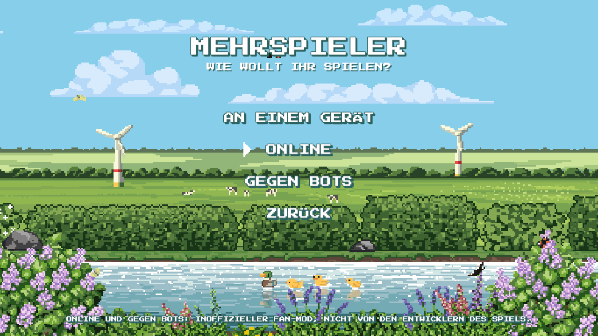 | 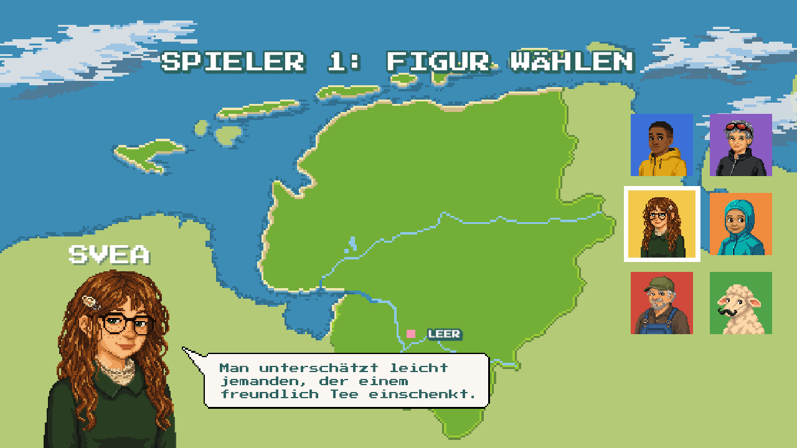 |
| **Mehrspieler-Auswahl** (`OnlineMenu`, Seite *Choice*) | **Figurenauswahl des Spiels** im 1-Spieler-Modus (`OnlineSetup`) |
| 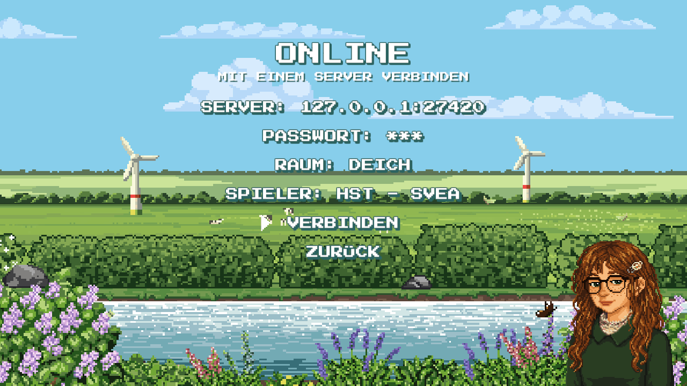 | 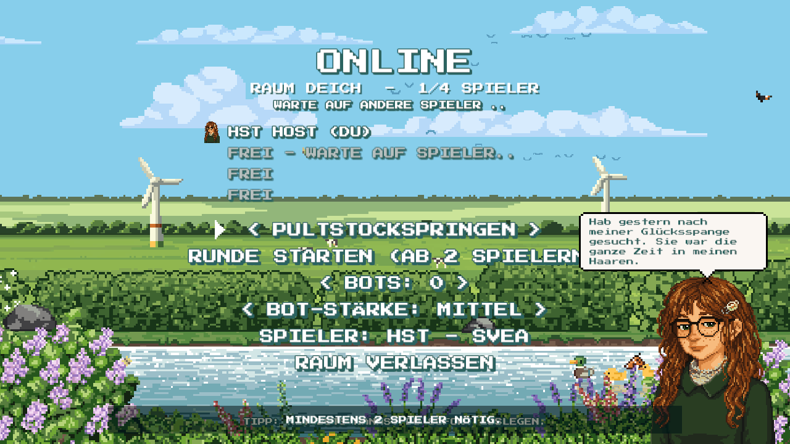 |
| **Verbinden** mit Figur + Spruch (`OnlineMenu`, *Connect*) | **Lobby** allein, Statuszeile „Warte auf andere Spieler“ |
| 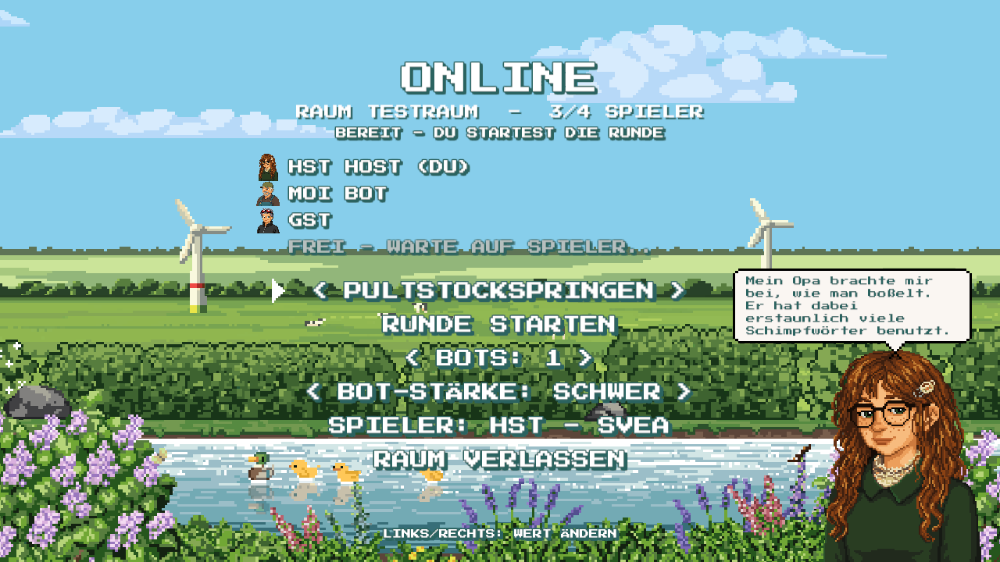 | 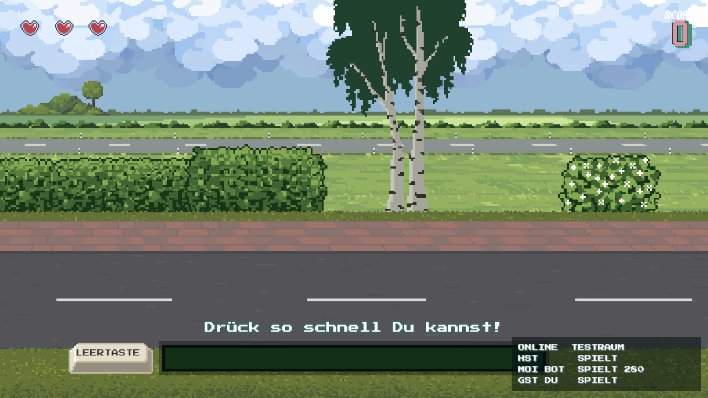 |
| **Lobby als Host**: Mitspieler, Server-Bot, Raum-Passwort, Spieler entfernen | **Laufende Runde** mit Spielerliste (`OnlineHud`) |
| 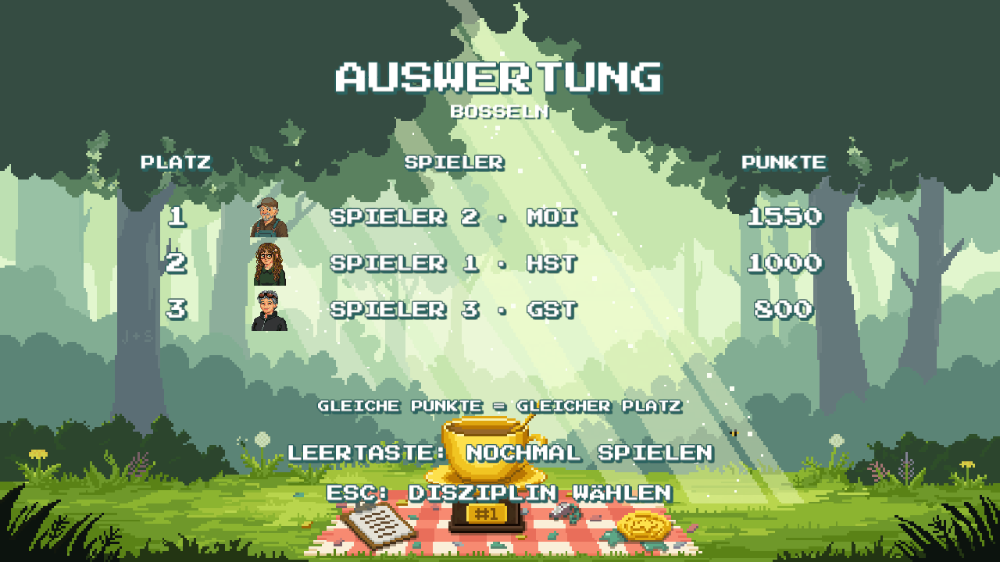 | 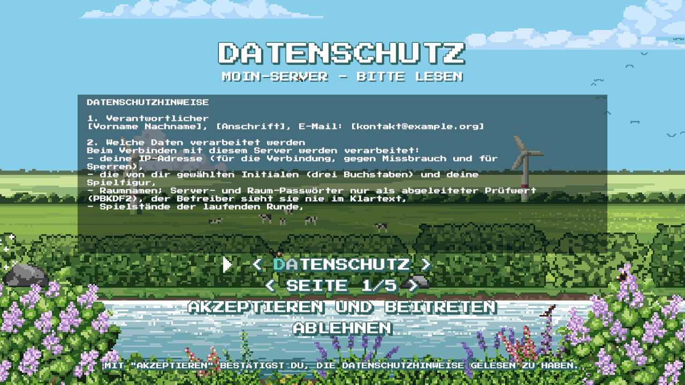 |
| **Ergebnis** im Original-Bildschirm | **Datenschutzhinweise** eines Public-Servers vor dem Beitritt (*Legal*) |
| 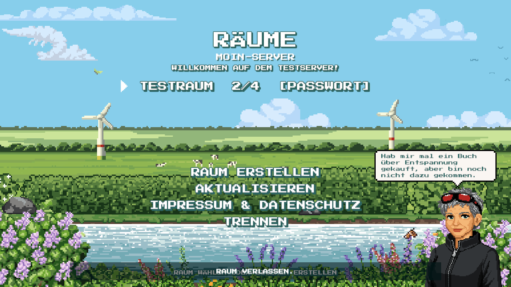 | 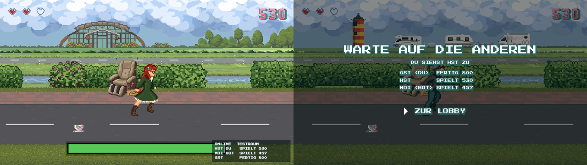 |
| **Raumliste** mit MOTD und passwortgeschütztem Raum (*Rooms*) | **Zuschauen**: links der Spieler, rechts der fertige Mitspieler mit gespiegelter Szene (`SceneMirror`) |

Alle Bilder stammen aus automatisierten Testläufen (Xvfb, siehe [Testen](#testen)).

## Überblick

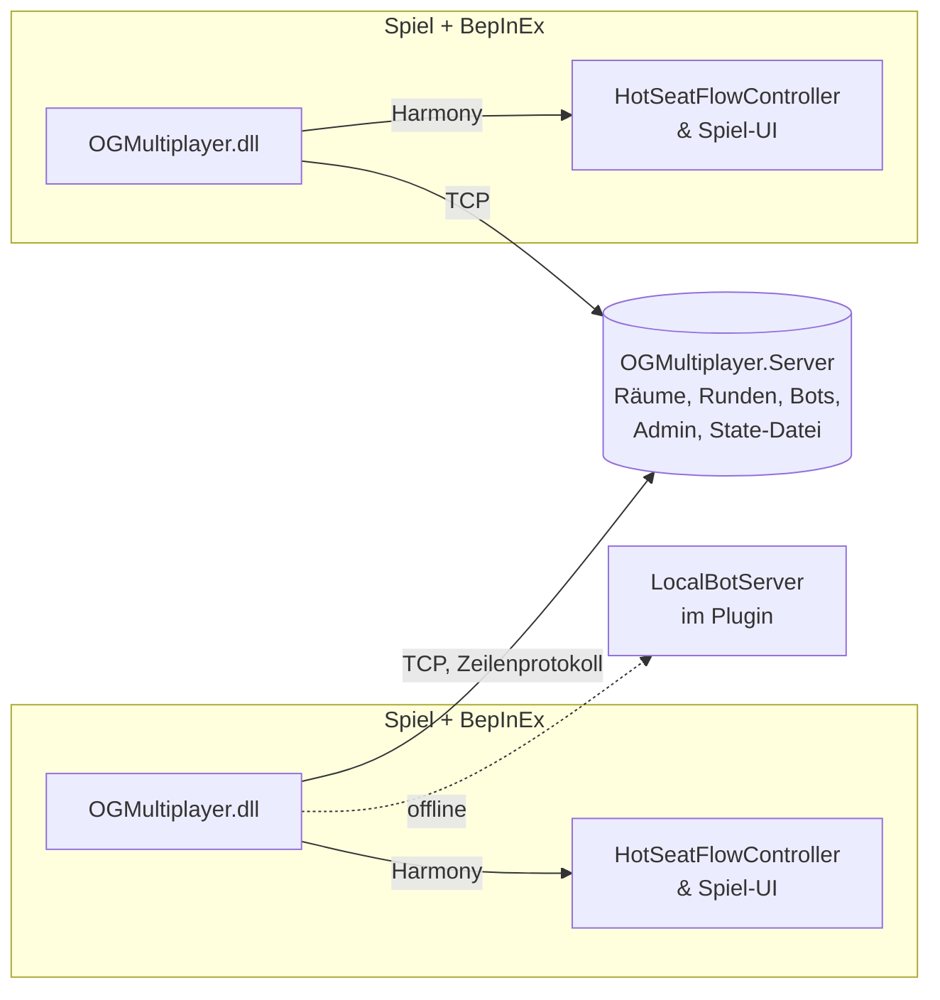

Grundidee: Das Spiel hat einen lokalen **Hot-Seat-Modus** (`HotSeatFlowController`):
Spieler wechseln sich ab, jede Disziplin meldet am Ende `TryCompleteTurn(score)`, danach
kommt ein Ergebnisbildschirm. Der Mod baut daraus eine Online-Runde, in der **alle
gleichzeitig** spielen:

1. Jeder Client erzeugt einen eigenen Hot-Seat-Controller mit allen Spielern des Raums,
   der **lokale Spieler immer auf Platz 1** (Turn 0).
2. Der eigene Zug startet erst, wenn der Server `GO` sendet (alle bereit).
3. Nach dem eigenen Zug wird nicht an „Spieler 2“ übergeben, sondern der Score an den
   Server geschickt.
4. Kommt `RESULT`, trägt der Client die Scores der anderen in die Hot-Seat-Runde ein und
   öffnet den normalen Ergebnisbildschirm des Spiels.

So bleiben alle Disziplinen, Countdown, Ergebnisanzeige, Revanche usw. Original-Spielcode.

## Repository

```
src/Shared/Protocol.cs              Wire-Protokoll (Plugin + Server teilen die Datei)
src/Shared/Bots.cs                  Bot-Verhalten (Plugin-Offline-Modus + Server)
src/OGMultiplayer.Plugin/           BepInEx-5-Plugin, netstandard2.1
  Plugin.cs                         Einstieg, Konfiguration, Harmony, Komponenten
  OnlineSession.cs                  Verbindung + Rundensteuerung (Zustandsautomat)
  NetClient.cs                      ITransport + TCP-Client (Hintergrundthread)
  LocalBotServer.cs                 ITransport ohne Netz für „Gegen Bots“
  Patches.cs                        Alle Harmony-Patches
  GameBridge.cs                     Zugriff auf nicht-öffentliche Spielteile (Reflection)
  OnlineSetup.cs                    Figurenauswahl des Spiels für 1 Spieler nutzen
  OnlineMenu.cs                     Online-Seiten im Stil der Spielmenüs (uGUI)
  OnlineHud.cs                      Overlay: Spielerliste, Banner, Meldungen
  SceneMirror.cs                    Zuschauen: Szenen-Spiegel (MirrorSender / MirrorView)
src/OGMultiplayer.Server/           .NET-8-Server, keine Abhängigkeiten
  Server.cs                         Netzwerk, Räume, Runden, Auth, Bots
  Admin.cs                          Admin-Befehle (stdin), Shutdown
  AdminSocket.cs                    Admin-Konsole auf einem Unix-Socket (--admin-socket)
  State.cs                          State-Datei (Bans, Passwort-Override)
  Program.cs                        CLI-Optionen, Signale
tests/OGMultiplayer.Server.Tests/   xUnit-Tests gegen echten Server auf Port 0
tests/OGMultiplayer.GameTests/      Test-Mod für Spieltests (scripts/game-test.sh)
scripts/install.sh                  BepInEx installieren + Plugin bauen (Linux/macOS-Shell)
scripts/install.ps1, install.cmd    dasselbe für Windows (PowerShell 5.1+, Doppelklick-Wrapper)
scripts/update-bepinex.sh           BepInEx-Pin auf neueste 5.x-Version heben
scripts/game-test.sh                Spieltests: zwei Instanzen + Test-Server unter Xvfb
flake.nix                           Pakete, Apps (install/play/server), NixOS-Modul
.github/                            CI, Wartung, Release, Dependabot
docs/screenshots/                   Bilder für diese Doku
```

## Bauen

Voraussetzungen: .NET SDK 8 (`nix develop` bringt es mit) und für das Plugin eine
Linux-Spielinstallation mit entpacktem BepInEx 5.

```bash
dotnet build src/OGMultiplayer.Server -c Release
```

```bash
dotnet test tests/OGMultiplayer.Server.Tests
```

```bash
dotnet build src/OGMultiplayer.Plugin -c Release -p:GameDir="/pfad/zu/Ostfriesland Games"
```

Das Plugin-Projekt referenziert `Assembly-CSharp.dll`, die Unity-Module aus
`OG_Data/Managed` und `BepInEx.dll`/`0Harmony.dll` aus `BepInEx/core` per `HintPath`
mit `Private=false`: nichts davon landet im Build-Ordner oder im Repo, und der Build braucht
keine NuGet-Pakete. `GameDir` geht auch per Umgebungsvariable `OG_GAME_DIR`.
`scripts/install.sh` erledigt BepInEx + Build + Kopie in `BepInEx/plugins/OGMultiplayer/`.

Getestet mit der Linux-Version auf **Unity 6000.4.0f1 (Mono)** und **BepInEx 5.4.23.4**.
Windows: Das Plugin ist plattformneutral (netstandard2.1, `BepInProcess` für `OG.x86_64` und
`OG.exe`); BepInEx kommt dort als `winhttp.dll`-Doorstop. `install.ps1` wurde unter `pwsh`
gegen eine nachgestellte Windows-Spielstruktur getestet, nicht auf einem echten Windows-System.
Der Server wird in der CI zusätzlich auf `windows-latest` gebaut und getestet.
Die Meldung `Unable to start Unity log writer` von BepInEx unter Unity 6 ist harmlos.

## Plugin

### Komponenten

`Plugin.Awake` bindet die Konfiguration (`BepInEx/config/de.onlh.ostfriesland.multiplayer.cfg`),
prüft per Reflection alle benötigten Spiel-Interna (`GameBridge.MissingMembers`,
`OnlineSetup.MissingMembers`; Fehlendes wird ins Log geschrieben), führt
`Harmony.PatchAll` aus und hängt an ein `DontDestroyOnLoad`-Objekt:

| Komponente | Aufgabe |
| --- | --- |
| `OnlineSession` | Verbindung, Lobby-Zustand, Online-Runde steuern, Nachrichten verarbeiten |
| `OnlineMenu` | Online-Seiten (Choice, Connect, Lobby) |
| `OnlineHud` | Overlay während Runden und im Hauptmenü |

### Transport

`ITransport` (`Send`, `TryReceive`, `Tick`, `LastError`) hat zwei Implementierungen:

- **`NetClient`**: TCP auf einem Hintergrundthread; empfangene Zeilen landen in einer
  `ConcurrentQueue` und werden in `OnlineSession.Update` auf dem Unity-Hauptthread
  verarbeitet. Einmal pro Verbindung, Trennung erzeugt eine Marker-Zeile.
- **`LocalBotServer`**: Für „Gegen Bots“. Spricht dasselbe Protokoll in-process für einen
  Menschen plus Bots, ohne Netz. Bot-Punkte orientieren sich an der lokalen Bestenliste
  (`GameBridge.LocalScores`).

Dadurch läuft der Offline-Modus durch exakt denselben Code wie Online-Runden.

### Ablauf einer Runde

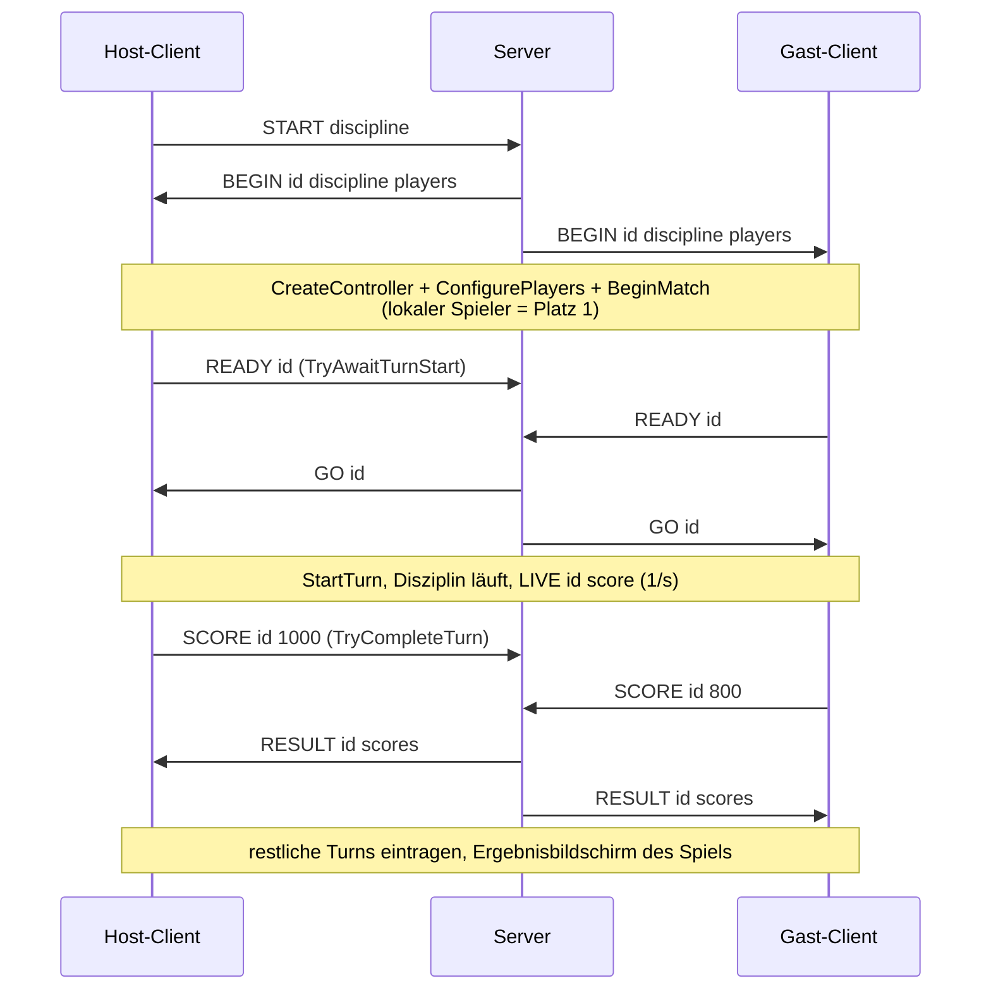

### Harmony-Patches

Alle Patches sind No-ops, solange der aktive `HotSeatFlowController` nicht vom Mod stammt
(`OnlineSession.IsOnlineController`, bzw. `OnlineSetup.IsSetupController`).

| Ziel | Art | Zweck |
| --- | --- | --- |
| `HotSeatFlowController.TryAwaitTurnStart` | Postfix | `READY` senden |
| `HotSeatFlowController.StartTurn` | Prefix | nur nach `GO` (Aufruf aus dem Mod mit `RunAuthorized`) |
| `HotSeatFlowController.TryCompleteTurn` | Prefix | eigenen Score eintragen, `SCORE` senden, kein Spielerwechsel |
| `HotSeatFlowController.SaveHighscores` | Prefix | nur eigener Score, nur lokal, nie in die Upload-Outbox |
| `HotSeatFlowController.BeginMatch` / `Rematch` / `ChooseDiscipline` | Prefix | nur Host; wird zu `START` |
| `HotSeatFlowController.EditPlayers` | Prefix | Online: zurück ins Menü statt lokaler Spielerwahl |
| `HotSeatFlowController.Abort` | Prefix | `LEAVE` senden (0 Punkte) |
| `HotSeatFlowController.ConfigurePlayers` | Prefix | Setup-Modus: gewählte Figur/Initialen übernehmen |
| `HotSeatCharacterSetup.Initialize` | Postfix | Setup-Modus: 1 Spieler, Start bei Figurenwahl |
| `HotSeatCharacterSetup.Back` | Postfix | Setup-Modus: Abbruch zurück ins Online-Menü |
| `StartScreenMenuController.OpenMultiplayer` | Prefix | „Mehrspieler“ öffnet die Auswahlseite |
| `StartScreenMenuController.Update` | Prefix | Hauptmenü verbergen/sperren, solange eine Online-Seite offen ist |
| `StartScreenCameraScroller.Update` | Prefix | kein Zurückscrollen zum Logo beim Schließen einer Online-Seite |
| `OnlineScoreSync.Send` | Prefix | Score-API des Spiels sperren, solange online |

### Spiel-Interna (`GameBridge`, `OnlineSetup`)

Was nicht öffentlich ist, wird ausschließlich in diesen beiden Dateien per `AccessTools`
angesprochen (private Setter, Felder `screen`, `waitingOwner`, Methoden
`RefreshHighscoreEligibility`, `PresentMenu`, `ScoreStore.doc/Save`, Registrierungs-Schritte
von `HotSeatCharacterSetup` …). Ändert ein Spiel-Update diese Stellen, meldet das Plugin beim
Start die fehlenden Member; angepasst werden muss dann nur hier.

`GameBridge.CreateController` erzeugt einen Hot-Seat-Controller wie
`HotSeatFlowController.Open`, aber ohne die lokale Spielerwahl.

### Spielerwahl über die Figurenauswahl des Spiels

`OnlineSetup.Begin` startet die echte Hot-Seat-Registrierung (Ostfriesland-Karte, Pins,
großes Portrait, Sprechblase, Initialen-Kästchen) mit einem eigenen Controller. Der
Postfix auf `HotSeatCharacterSetup.Initialize` setzt `PlayerCount = 1` und springt direkt
zur Figurenwahl; der Prefix auf `ConfigurePlayers` liest Figur und Initialen ab, speichert
sie in der Konfiguration und kehrt ins Start-Menü zurück (`OnlineSetup.Finished`), wo
`OnlineMenu` die passende Seite öffnet. Die Initialen-Sperrliste des Spiels gilt dabei.

### Menüs und HUD

Seiten: *Choice* (Mehrspieler-Auswahl), *Connect* (Server, Passwort, Spieler), *Legal*
(Datenschutz/Impressum/Regeln, seitenweise, mit Zustimmung bei Public-Servern), *Rooms*
(Raumliste, Beitritt mit Passwort-Eingabe), *CreateRoom*, *Lobby*. Übergänge folgen dem
Sitzungszustand (`NeedsConsent`, `Connected`, `InRoom`).

`OnlineMenu` hat eigene Widgets; das Aussehen kommt zur Laufzeit aus dem Spiel: Canvas-
Einstellungen und Auswahlpfeil des Start-Menüs, `ApplyMultiplayerTextStyle`,
`ApplyMultiplayerSelectionEffect`, `PauseMenuTheme` (Skalierung, Puls, Umriss),
`WhitePixelSprite`. Eingaben laufen über `ArcadeInput` (Tastatur/Controller); Mausklicks über
eine eigene kleine `MenuClick`-Komponente (kein `Button`, also nie Tastaturfokus). Textfelder (Server, Passwort, Raum) werden
inline mit `Input.inputString` bearbeitet. Rechts steht die gewählte Figur
(`bigPortrait`, unten am Bildrand verankert) mit einem Spruch aus `CharacterQuotes`
in einer selbst gezeichneten 9-Slice-Sprechblase in den Farben der Spiel-Blase.

Wichtige Regeln:

- Lobby verlassen (`Raum verlassen`/Esc) führt online in die Raumliste, offline beendet es das Spiel gegen Bots; *Trennen* in der Raumliste beendet die Verbindung.
- Nach `VERBINDEN` geht es automatisch in die Lobby; erneutes Drücken trennt nicht.
- Endet eine Online-Runde (Ergebnis → Menü), öffnet sich die Lobby wieder
  (`OnlineSession.ReturnToLobby`). Gäste verlassen das Ergebnis mit der Zurück-Taste des
  Spiels, laufende Runden über das Pausemenü des Spiels („Zum Start“).
- **Keine eigenen Tasten, die das Spiel schon belegt.** Der Mod nutzt nur die Menü-Eingaben
  des Spiels (`ArcadeInput`, gleiche Bedeutung wie in den Spielmenüs) und F6 als Abkürzung
  (F2/F8/F9/F10 sind Entwicklertasten des Spiels). Text wird nur getippt, während eine
  Online-Seite offen ist und das Hauptmenü keine Eingaben bekommt.

`OnlineHud` ist ein Overlay-Canvas (Sortierung 900) mit Spielschrift und Schatten:
Spielerliste (Ecke konfigurierbar), Warte-Banner, Meldungen. Auf den Ergebnis-/Setup-Seiten
des Spiels ist die Liste aus.

### Zuschauen (Szenen-Spiegel)

Wer fertig ist, sieht dem besten noch spielenden Menschen zu (Server wählt; Wechsel erst, wenn
der Beobachtete fertig ist oder jemand 5 s lang 15 % vorne liegt). Statt Video oder
Eingaben wird der **Szenenzustand** übertragen (`SceneMirror.cs`):

- Beide Seiten laden dieselbe Disziplin-Szene. Objekte werden über ihren Hierarchiepfad
  (`/Name#n/Kind#n`, `n` zählt gleichnamige Geschwister) zugeordnet. Ausgenommen sind
  Pausemenü und seine Seiten sowie Eingabe-Hinweise, die für Zuschauer nur verwirrend wären
  (`Mirror.IsPrompt`: vom Spiel als `IngameHudHint` markiert, Bosseln-Wurfanzeige mit
  Kraftbalken und Aufforderung); der Zuschauer blendet seine eigenen aus. Andere Texte,
  Punkte und Herzen bleiben. Ein einzelner Eintrag über `MaxViewChars` wird nie gesendet
  (Texte werden auf 400 Zeichen gekürzt), damit der Server den Spieler nicht wegen einer zu
  langen Zeile trennt. Der Server leitet `VIEW` nur weiter, solange die Warteschlange des
  Zuschauers kurz ist (sonst verdrängten sie `GO`/`RESULT`); hat er Zeilen ausgelassen,
  fordert er beim Spieler einen Vollstand an.
- Der Spieler merkt sich zwei Frames nach dem Laden den Ausgangszustand und sendet bis zu 10×/s
  nur Abweichungen: lokale Position/Rotation/Skalierung, aktiv, Sprite/Farbe/Flip/enabled von
  `SpriteRenderer`/`Image`/`Text`, `sizeDelta`, Kamera-`orthographicSize`. Werte sind
  quantisiert, damit „unverändert“ exakt gleich ist; Transform-Werte werden nur bei
  `Transform.hasChanged` gelesen. Eine Zeile bleibt unter `MaxViewChars`, der Rest folgt im
  nächsten Takt (Round-Robin). Während des Spiels erzeugte Objekte gehen mit Art und
  Sortierung raus (Kinder erst nach ihrem neuen Elternobjekt) und werden beim Zuschauer als
  schlichte Stellvertreter angelegt. Neue Objekte werden alle 0,3 s gesucht.
- **Datenmenge** (`MirrorWire`): binär statt Text – pro Objekt Nummer + Feldmaske, Zahlen als
  Zickzack-Varint der *Differenz* zum zuletzt gesendeten Wert (meist 1 Byte), Pfade, Sprite-
  Namen und Sortierebenen über eine String-Tabelle (einmal definiert, danach nur Index), Zeile
  mit Deflate, wenn das kleiner ist (spart noch rund ein Drittel), base64 in der Zeile. Sprites,
  die weiter als eine halbe Bildgröße außerhalb der Kamera liegen, werden erst gesendet, wenn
  sie näher kommen (das Update, mit dem sie den Bereich verlassen, geht noch raus). In Bosseln
  sind es so rund 2 KB/s statt vorher rund 10 KB/s. Weil Differenzen aufeinander aufbauen,
  prüft der Zuschauer die Bildnummern; bei einer Lücke ignoriert er alles bis zum nächsten
  Vollstand (Kopf-Bit *Reset*: String-Tabelle und Zuordnungen beginnen neu) und fordert ihn an.
- Spuren (Ball-Pixelspur in Bosseln) rechnet der Zuschauer selbst aus der gespiegelten
  Ballposition (`BosselnBallVisual.UpdatePixelTrail` per Reflection), der Rest des Ballskripts
  bleibt eingefroren.
- Der Zuschauer lädt die Szene neu, lässt ihre Skripte zwei Frames lang aufbauen und friert
  dann ein: Spiel-`MonoBehaviour`s (außer Pausemenü und UI-Bausteine) aus, Coroutinen
  gestoppt, Animatoren aus, Physik aus, Szenen-Audio stumm. Positionen gleiten den
  gesendeten nach. Darüber liegt eine Lobby-Seite, gebaut wie das Pausemenü des Spiels
  (`PauseMenuTheme`: Abdunklung über den ganzen Bildschirm, Titel, Schrift, Auswahleffekt,
  `MenuSelectionArrow`; in `OnlineHud`):
  wer fertig ist, wer noch spielt, wem man zusieht, und *Zur Lobby* (Bestätigen-Eingabe
  des Spiels, erst nach 1,5 s und nachdem gehaltene Tasten losgelassen wurden – sonst
  würde Tastendrücken vom Ende der eigenen Runde das Overlay sofort auslösen). Wechselt der Beobachtete, wird alles zurückgesetzt und per `VIEWKEY` ein
  vollständiger Stand angefordert.
- Gestreamt wird nur, solange jemand zuschaut. Opt-out pro Spieler (`VIEWPREF`, Menüzeile
  *Zuschauen*) und pro Server (`--no-spectate`, Admin `spectate off`).

Grenzen: Partikel, `LineRenderer` und zur Laufzeit gezeichnete Texturen werden nicht
übertragen; zufällig aufgebaute Szenen können an einzelnen Stellen abweichen.

### Score-API des Spiels

`OnlineScoreSync` schickt alle HTTP-Anfragen über die Coroutine `Send(UnityWebRequest)`.
Solange `OnlineSession.BlocksScoreApi` gilt (TCP-Verbindung offen oder Online-Controller
aktiv, abschaltbar per `Privacy.BlockScoreApiWhileOnline`), liefert der Prefix eine leere
Coroutine: die Anfrage wird nie gestartet, das Spiel behandelt sie als Fehler und versucht
es später. Zusätzlich entfernt `GameBridge.SubmitLocalOnly` Scores aus Online-Runden sofort
wieder aus der Upload-Outbox.

## Protokoll

Definiert in [`src/Shared/Protocol.cs`](src/Shared/Protocol.cs). Eine Nachricht = eine
UTF-8-Zeile, Felder durch Tab getrennt, Unterfelder durch `|`. Version: **1**.

| Richtung | Nachricht | Bedeutung |
| --- | --- | --- |
| S→C | `CHALLENGE ver nonce pwRequired public privacyHash name` | sofort nach dem Verbinden |
| C→S | `DOC privacy\|imprint\|rules` | Rechtstext anfordern (auch vor `HELLO`) |
| S→C | `DOCTEXT kind text` | Text mit `EscapeText` (Backslash, Tab, Zeilenumbruch) |
| C→S | `HELLO ver INI char room proof consent` | `proof` = `AuthProof(ServerKey(pw), nonce)` oder leer; `consent` = akzeptierter `privacyHash`; leerer `room` = Raumliste |
| S→C | `WELCOME id` / `ERROR text` / `BYE grund` | Antwort / Fehler / Trennung mit Grund |
| S→C | `SERVERINFO name public motd docs` | nach `WELCOME` und bei MOTD-Änderung |
| C→S / S→C | `ROOMS` / `ROOMLIST maxRooms room*` | `room` = `name\|spieler\|max\|state\|locked\|hostINI`; wird bei Änderungen an alle in der Raumliste gepusht |
| C→S | `CREATE name roomKey` / `JOIN name proof` | `roomKey` = `RoomKey(pw, name)` oder leer; `proof` = `AuthProof(roomKey, nonce)` |
| S→C | `JOINED name` / `ROOMLEFT grund` | in einen Raum / zurück in die Raumliste |
| C→S | `LEAVEROOM` / `ROOMPW roomKey` / `KICK id` | Raum verlassen / Host: Passwort setzen (leer = aus) / Host: Spieler oder Bot entfernen |
| S→C | `LOBBY room hostId state botLevel locked player*` | `player` = `id\|INI\|char\|status\|score\|bot[\|graceLeft]`; `status` `paused` bei offener Pause, `graceLeft` = Sekunden, bis ihr Live-Stand zählt (nur solange niemand sonst spielt) |
| C→S | `CHAR characterId` | Figur in der Lobby ändern |
| C→S | `BOT ADD` / `BOT REMOVE` / `BOT LEVEL n` | nur Host, nur in der Lobby |
| C→S | `START discipline` | nur Host |
| S→C | `BEGIN matchId discipline player*` | `player` = `id\|INI\|char` |
| C→S | `READY matchId` | Client wartet am Rundenstart |
| S→C | `GO matchId` | alle bereit (oder Ready-Timeout) |
| C→S | `LIVE matchId score` | Live-Punkte (Padstock, Bosseln, Krabbenpulen) |
| C→S | `VIEWPREF 0\|1` | Opt-out: 0 = niemand darf mir zuschauen (nach `WELCOME` und bei Änderung) |
| S→C | `WATCH matchId playerId` | wem ich zuschauen kann (0 = niemandem); nur an Fertige/Nicht-Mitspieler |
| C→S | `VIEWKEY matchId` | Zuschauer-Szene bereit, bitte vollständigen Stand |
| S→C | `STREAM matchId 0\|1` | an den Beobachteten: Szene spiegeln (1, erneut = vollständiger Stand) |
| C→S / S→C | `VIEW matchId frame record*` / `VIEW playerId frame record*` | Szenen-Spiegel, Server leitet nur an aktive Zuschauer weiter |
| C→S | `PAUSE matchId 0\|1` | Pausemenü des Spiels geöffnet/geschlossen (eigene laufende Runde) |
| C→S | `SCORE matchId score` / `LEAVE matchId` | Runde fertig / abgebrochen (0 Punkte) |
| S→C | `RESULT matchId id\|score*` | alle fertig |
| S→C | `MSG text` | Admin-Nachricht |
| beide | `PING` / `PONG` | Keepalive (Client alle 5 s) |

Disziplinen: `0` Padstock, `1` Schlick, `2` Bosseln, `3` Teezeremonie, `4` Krabbenpulen.
Bei inkompatiblen Änderungen `Protocol.Version` erhöhen; der Server lehnt andere Versionen ab.

## Server

### Aufbau

- `TcpListener`, pro Verbindung ein Lese-Task; **alle Zustandsänderungen unter einem Lock**
  (`sync`), daher keine Races zwischen Räumen, Runden, Admin und Tick.
- Ausgehende Zeilen gehen über einen begrenzten `Channel` pro Client mit eigenem
  Schreib-Task, langsame Clients blockieren niemanden.
- Ein Tick pro Sekunde: Timeouts, Ready-Timeout, Match-Timeout, Bots, Aufräumen.

| Grenze | Standard |
| --- | --- |
| Spieler pro Raum | 2–4 (Bots zählen mit) |
| Handshake / Idle | 15 s (15 min beim Lesen der Rechtstexte) / 30 s, Client-Ping alle 5 s |
| Räume / Verbindungen pro IP | unbegrenzt, mit `--public` 50 / 3 |
| Nachrichten pro Verbindung | 30 pro Sekunde |
| Warten auf `READY` aller | 60 s, danach `GO` für die Bereiten |
| maximale Rundendauer | 20 min, Unfertige bekommen 0 |
| Passwort-Fehlversuche | 5 in 5 min pro IP, danach Sperre |
| Zeilenlänge | 4096 Zeichen |

### Räume und Runden

Der erste menschliche Spieler im Raum ist Host. `START` legt eine `Match` mit allen
aktuellen Mitgliedern an; wer später kommt, wartet bis zur nächsten Runde. Verlässt ein
Spieler die Runde oder trennt die Verbindung, bekommt er 0 Punkte. Sobald alle fertig sind,
geht `RESULT` an alle Mitglieder und der Raum ist wieder in der Lobby. Räume ohne Menschen
werden geschlossen.

Pausen: Der Client meldet das Pausemenü des Spiels (`PauseManager.IsAnyPaused`) mit
`PAUSE`. Solange noch jemand anderes spielt, kostet eine Pause nichts. Spielt niemand
mehr (alle anderen fertig oder ebenfalls pausiert), läuft das Pausenbudget
(`--pause-grace`, Standard 60 s) ab; nur pausierte Zeit zählt, Weiterspielen hält den
Countdown an. Ist es aufgebraucht, zählt der letzte `LIVE`-Stand als Ergebnis, `RESULT`
geht an alle, und der Client schließt die Pause und zeigt das Ergebnis. Der Countdown
steht bei allen im HUD, beim Pausierenden über dem Pausemenü.

### Bots

Bots sind `Client`-Objekte ohne Verbindung (`IsBot`). Beim `START` bekommen sie einen
Zielwert (`Bots.TargetScore`) und eine Dauer (20–60 s); während der Runde wächst ihr
Live-Score linear, spätestens wenn alle Menschen fertig sind, melden sie ihren Endstand.

Zielwert = Referenz × Faktor (leicht 0,55 / mittel 0,88 / schwer 1,2) × Streuung 0,75–1,25.
Referenz ist der Median der letzten echten Ergebnisse dieser Disziplin auf dem Server
(offline: der lokalen Bestenliste), ohne Daten 1050 (Mitte der Startwerte der
Spiel-Bestenliste 600–1500).

### Passwörter

Server- und Raum-Passwörter: Der Client rechnet `ServerKey(pw)` bzw. `RoomKey(pw, raum)` =
PBKDF2-HMAC-SHA256 (30 000 Runden, Salt `ogmp-server:v1` bzw. `ogmp-room:<raum>`) und schickt
`AuthProof(key, nonce)` = HMAC-SHA256 mit der Verbindungs-Nonce. Der Server hält nur Schlüssel
(Vergleich mit `CryptographicOperations.FixedTimeEquals`), leitet `--password-file` beim Start
sofort ab, speichert per Konsole gesetzte Passwörter nur als Schlüssel (alte Klartext-Einträge
werden beim Laden migriert) und maskiert `password …` im Log.

PBKDF2 ist in `Protocol.Pbkdf2Sha256` selbst implementiert: Das Mono des Spiels ignoriert das
Hash-Argument von `Rfc2898DeriveBytes` (Ergebnis wäre PBKDF2-SHA1). Ein Test prüft gegen den
RFC-7914-Testvektor und gegen .NET.

### Raumliste und Public-Modus

Nach `HELLO` ohne Raum ist ein Client in der Raumliste (`Authed`, aber `Room == null`).
`CREATE`/`JOIN`/`LEAVEROOM`/`KICK` laufen über `JoinRoom`/`LeaveRoom` in `Server.cs`; Räume ohne
Menschen schließen sich. Die Raumliste wird nur bei Änderungen an alle Clients in der
Raumliste geschickt (Vergleich mit der zuletzt gesendeten Zeile).

`--public` verlangt Impressum + Datenschutz (`LoadDocuments`, max. ca. 60 000 Zeichen je
Text), setzt Standardgrenzen (50 Räume, 3 Verbindungen/IP) und maskiert IPs im Log
(`LogAddress`). Wer vor `HELLO` einen Rechtstext anfordert (`DOC`), bekommt 15 Minuten statt
15 Sekunden Handshake-Zeit zum Lesen. `HELLO` wird ohne passenden `consent`-Hash abgelehnt.
Pro Verbindung gilt ein Limit von 30 Nachrichten/Sekunde (`Kick`).

### Admin-Konsole und State-Datei

Befehle kommen zeilenweise von stdin (`Admin.cs`, `help`) oder über `--admin-socket`
(`AdminSocket.cs`): jede Socket-Verbindung ist eine eigene Konsole mit eigenem Ausgabekanal
(gebunden, 1000 Zeilen, älteste fallen weg). `Log` schreibt auf stdout und in alle Sitzungen
außer der, die den Befehl geschickt hat; Antworten von `ExecuteAdmin` gehen nur an die fragende
Sitzung. Ende der Eingabe schließt die Sitzung, nachdem die Antworten raus sind. Der Socket
wird mit 0600 angelegt, ein verwaister beim Start ersetzt und beim Beenden gelöscht; Pfade über
107 Bytes lehnt der Server ab. `shutdown` kündigt den Neustart
im Spiel an (`MSG`), trennt alle mit `BYE` und beendet den Server; SIGTERM/Strg+C laufen
denselben Weg.

Bans und Passwort-Änderungen per Konsole landen in einer JSON-State-Datei
(`--state-file`, Standard `./ogmultiplayer-state.json`): atomar geschrieben (Temp-Datei +
Rename), Modus 0600. Eine kaputte Datei verhindert den Start, damit Bans nicht still
verloren gehen. Jeder Ban hat ein Ablaufdatum (`ExpiresUtc`, Standard 30 Tage, auf ein Jahr
ab `CreatedUtc` begrenzt, auch beim Laden); der Tick entfernt abgelaufene Bans und schreibt
die Datei neu, ins Log nur die Anzahl, nie die IP.

## Testen

**Automatisch:** `tests/OGMultiplayer.Server.Tests` startet echte Server auf Port 0 und
spricht das Protokoll per TCP: Auth (richtig/falsch/fehlend/Sperre), kompletter
Rundenablauf, Abbruch, Raumlimit, Admin-Befehle, Shutdown, State-Datei über Neustarts,
Bots. Läuft in der CI.

**Im Spiel:** `tests/OGMultiplayer.GameTests` ist ein Test-Mod (BepInEx-Plugin, wird nie von
den Installationsskripten installiert). `scripts/game-test.sh "/pfad/zum/Spiel" [szenario …]`
baut Plugin, Test-Mod und Server, legt zwei Spielinstanzen in einem temporären Ordner an
(Spieldateien als Hardlinks, eigenes `BepInEx/`; die echte Installation bleibt unberührt),
startet einen Test-Server und beide Spiele unter `xvfb-run` als Host und Gast:

```bash
scripts/game-test.sh "$HOME/Games/Ostfriesland Games"                 # online, Bosseln
scripts/game-test.sh "$HOME/Games/Ostfriesland Games" online:all pause # alle Disziplinen + Pause
SHOTS=/tmp/shots scripts/game-test.sh "$HOME/Games/Ostfriesland Games" # mit Screenshots
```

Szenarien: `online` – verbinden, Raum, Start, Gast ist zuerst fertig und muss dem Host
zusehen (Zuschauer-Ziel, gespiegelte Szene, gebundene Objekte), Ergebnis mit beiden Punkten,
zurück in die Lobby. `pause` – der Gast pausiert, nach dem Host läuft die Pausen-Frist ab
(Server mit `--pause-grace 8`), der Gast bekommt trotzdem das Ergebnis. Disziplin per
`:0`…`:4` oder `:all`. Jede Prüfung schreibt `PASS`/`FAIL` in eine Ergebnisdatei; das Skript
fasst sie zusammen und endet mit Fehlercode, wenn etwas fehlschlägt (dann bleibt der
temporäre Ordner mit allen Logs liegen). In der CI läuft das nicht – dort gibt es das Spiel nicht.

Bekannte Lücken: kein Test mit echtem Controller, kein Spieltest unter echtem Windows.

## Automatisierung

| Workflow | Auslöser | Inhalt |
| --- | --- | --- |
| `ci.yml` | Push, PR | Server bauen + testen (Linux + Windows), PowerShell-Installer parsen, `nix flake check`, Nix-Builds, shellcheck, actionlint; Dependabot-Automerge (Patch/Minor) nach grünem CI |
| `maintenance.yml` | montags, manuell | `nix flake update` + `scripts/update-bepinex.sh`, alles prüfen, PR erstellen und mergen |
| `release.yml` | Tag `v*` | Tests, Server als Single-File für linux-x64/linux-arm64/win-x64, GitHub-Release |

Das Plugin kann die CI nicht bauen (es braucht die Spiel-DLLs), daher gibt es auch keine
Plugin-Releases; Nutzer bauen es bei der Installation selbst.

## Konventionen

- Keine Dateien des Spiels ins Repo (auch keine dekompilierten Quellen).
- **Kein Spielcode im Quellbaum, auch nicht nachgeschrieben.** Spielcode wird nur zur Laufzeit
  aufgerufen (öffentlich oder per Reflection über `GameBridge`). Statt eine Zuordnung oder
  Hilfsmethode des Spiels nachzubauen, die Methode des Spiels aufrufen (z. B.
  `GameBridge.GameScene`, `GameBridge.DisciplineName`).
- Zugriff auf private Spiel-Interna nur über `GameBridge`/`OnlineSetup`.
- Sichtbare Texte auf Deutsch in Großbuchstaben wie im Spiel; die Pixel-Schrift kann Umlaute.
- Protokolländerungen immer in `src/Shared/Protocol.cs` dokumentieren und in Plugin und
  Server gleichzeitig umsetzen; Server-Tests ergänzen.
- Commits: Autor Leon Hubrich, Claude als `Co-Authored-By`.
