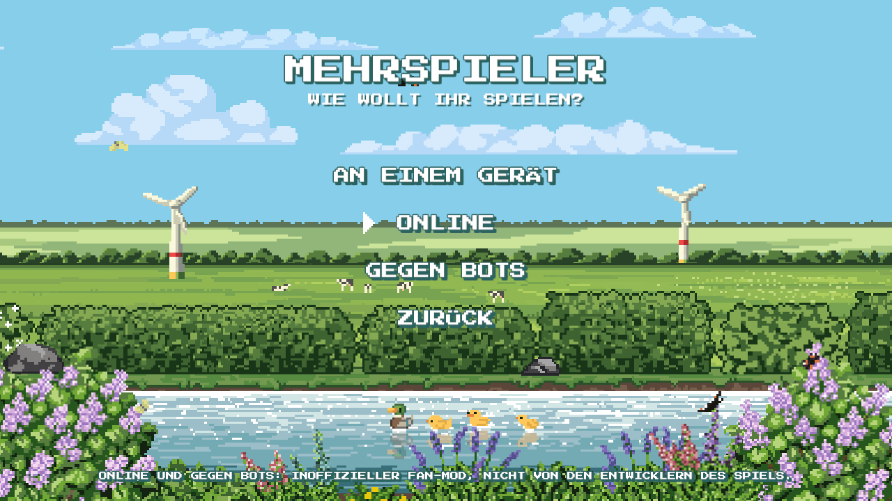
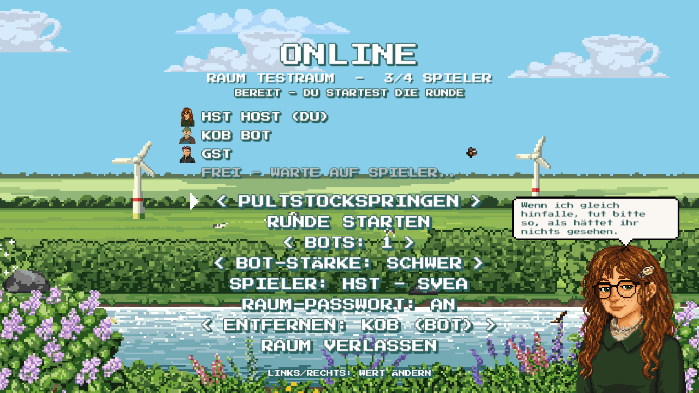
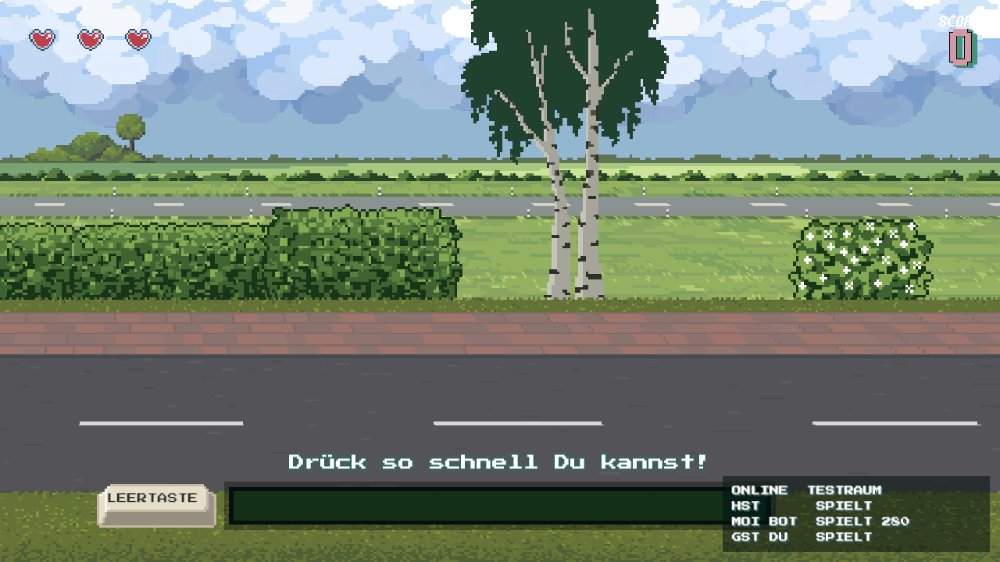
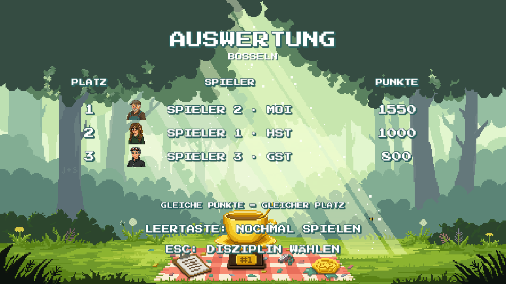
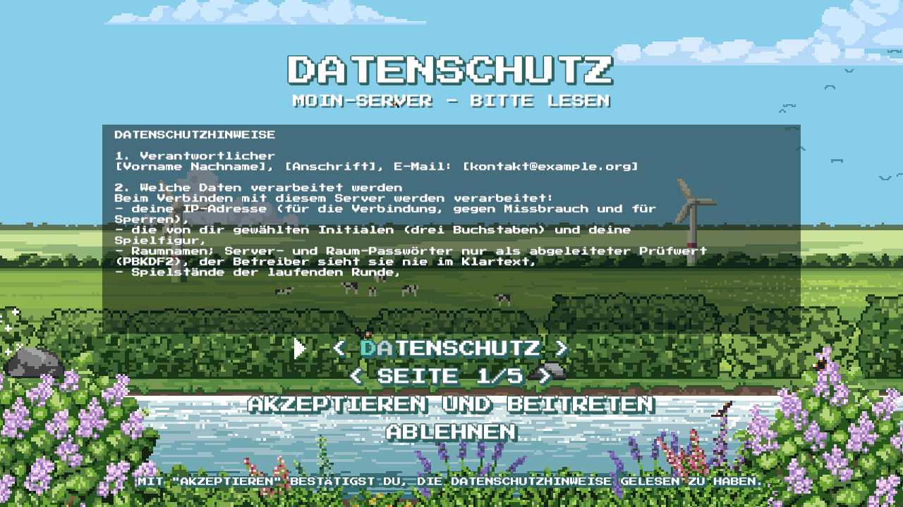
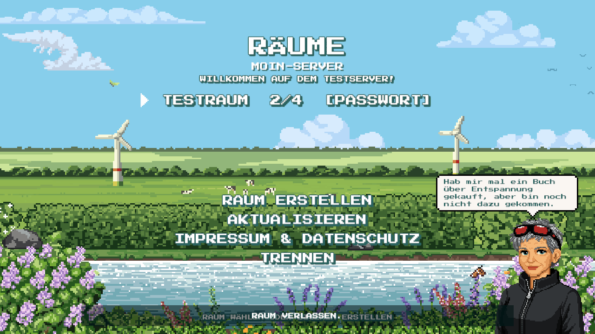

# Ostfriesland Games – Online-Mehrspieler

> **Inoffizieller Fan-Mod.** Dieses Projekt steht in keiner Verbindung zu den Entwicklern oder
> Rechteinhabern von *Ostfriesland Games* und wird von ihnen weder unterstützt noch geprüft.
> Fehler im Online-Modus bitte hier melden, nicht beim Spiel-Support. Nutzung auf eigene Gefahr;
> ein Spiel-Update kann den Mod jederzeit unbrauchbar machen.

Ein [BepInEx](https://github.com/BepInEx/BepInEx)-Mod plus kleiner Server, der den
lokalen Hot-Seat-Modus von *Ostfriesland Games* ins Netz bringt.

| | |
| --- | --- |
|  |  |
|  |  |
|  |  |

Technische Details: [Developer.md](Developer.md).

Alle Spieler eines Raums spielen **gleichzeitig dieselbe Disziplin auf ihrem eigenen
Rechner**. Der Server sorgt für einen gemeinsamen Start, zeigt live, wer noch spielt
(bei Padstockspringen, Bosseln und Krabbenpulen inkl. Live-Punkten), sammelt die
Ergebnisse ein und schickt sie an alle zurück. Das Ergebnis erscheint im
Original-Ergebnisbildschirm des Spiels.

- 2–4 Spieler pro Raum, beliebig viele Räume pro Server
- **Bots**: der Host füllt freie Plätze mit Bots (leicht/mittel/schwer); **Gegen Bots** geht
  auch ganz ohne Server
- Menüs im Stil des Spiels: Hauptmenü → *Mehrspieler* → *An einem Gerät* / *Online* / *Gegen Bots*
- alle fünf Disziplinen: Padstockspringen, Schlickschlitten, Bosseln, Teezeremonie, Krabbenpulen
- der erste Spieler im Raum ist Host und wählt Disziplin bzw. Revanche
- wer abbricht oder die Verbindung verliert, bekommt 0 Punkte – die Runde läuft für die anderen weiter
- lokale Bestenliste: nur der eigene Score wird auf dem eigenen Rechner gespeichert
- keine Verbindungen zur Online-Bestenliste des Spiels, solange der Online-Modus verbunden ist;
  Online-Runden landen nie in der weltweiten Bestenliste

> **Keine Spieldateien im Repo.** Der Mod wird gegen deine eigene Spielinstallation
> kompiliert; BepInEx wird beim Installieren direkt von dessen GitHub-Releases geladen.

## Installation

Du brauchst eine Linux-Version des Spiels (Ordner mit `OG.x86_64` und `OG_Data/`).

### NixOS / Nix

```bash
nix run github:AWildLeon/Ostfriesland-Games-Multiplayer#install -- "/pfad/zu/Ostfriesland Games"
```

Das entpackt BepInEx 5.4.23.4 (gepinnt per Hash) in den Spielordner und baut das
Plugin nach `BepInEx/plugins/OGMultiplayer/`.

Spiel starten (FHS-Umgebung via `steam-run-free`):

```bash
nix run github:AWildLeon/Ostfriesland-Games-Multiplayer#play -- "/pfad/zu/Ostfriesland Games"
```

Voraussetzung: `hardware.graphics.enable = true;` in deiner NixOS-Konfiguration.
Über Steam gestartet: Startoption `./run_bepinex.sh %command%`.

### Andere Linux-Distributionen

Benötigt: .NET SDK 8, `unzip`, `curl`.

```bash
git clone https://github.com/AWildLeon/Ostfriesland-Games-Multiplayer
```

```bash
Ostfriesland-Games-Multiplayer/scripts/install.sh "/pfad/zu/Ostfriesland Games"
```

```bash
cd "/pfad/zu/Ostfriesland Games" && ./run_bepinex.sh
```

## Spielen

1. Spiel mit BepInEx starten, im Hauptmenü **Mehrspieler → Online** wählen (Abkürzung: **F8**).
   *An einem Gerät* ist der normale Hot-Seat-Modus des Spiels.
2. Es öffnet sich die **Figurenauswahl des Spiels** (Ostfriesland-Karte, Initialen-Kästchen) –
   genau wie beim Mehrspieler an einem Gerät, nur für dich allein. Figur wählen, Initialen
   eingeben, bestätigen. Später änderbar über die Zeile *Spieler* (öffnet wieder die Auswahl).
3. Auf der Online-Seite Server und ggf. Server-Passwort einstellen → **Verbinden**.
   Bedienung wie in den Spielmenüs: Hoch/Runter wählen, Bestätigen öffnet ein Feld zum Tippen
   (Enter übernimmt, Esc bricht ab), Links/Rechts ändert Werte; Maus geht auch.
   Rechts steht deine gewählte Figur mit einem ihrer Sprüche aus der Figurenauswahl des Spiels.
   Auf einem **öffentlichen Server** erscheinen zuerst Datenschutzhinweise und Impressum des
   Betreibers; erst nach *Akzeptieren und beitreten* geht es weiter (einmal pro Server und
   Fassung der Datenschutzhinweise).
4. In der **Raumliste** einem Raum beitreten (bei *[Passwort]* das Raum-Passwort eintippen) oder
   *Raum erstellen* (Name, optional Passwort). Die Lobby zeigt in einer Statuszeile, worauf
   gewartet wird („Warte auf andere Spieler …“, „Warte auf den Host …“).
   *Raum verlassen* (oder Esc) führt zurück in die Raumliste, *Trennen* dort beendet die
   Verbindung. Nach einer Runde kommst du automatisch zurück in die Lobby.
5. Sobald mindestens zwei Spieler (oder Bots) im Raum sind, wählt der Host die Disziplin
   und startet die Runde. Als Host kannst du außerdem ein Raum-Passwort setzen/entfernen und
   Spieler oder Bots aus dem Raum entfernen.
6. Alle Spiele laden die Disziplin; gestartet wird erst, wenn alle bereit sind.
7. Nach deinem Lauf wartest du auf die anderen, danach kommt der gemeinsame Ergebnisbildschirm.
   Dort startet der Host per Revanche-Taste (Leertaste) die nächste Runde oder wählt eine andere Disziplin.

Unten rechts siehst du während einer Runde alle Spieler mit Status und Punkten.

### Bots

- **Online:** Der Host stellt in der Lobby *Bots* (Anzahl) und *Bot-Stärke* ein. Bots belegen
  Plätze im Raum, sind sofort bereit, zeigen Live-Punkte und sind spätestens kurz nach dem
  letzten Menschen fertig. Ihre Punkte orientieren sich am Median der echten Ergebnisse auf
  dem Server (anfangs an den Startwerten der Spiel-Bestenliste, 600–1500): *leicht* ≈ 55 %,
  *mittel* ≈ 88 %, *schwer* ≈ 120 %, jeweils mit Streuung.
- **Gegen Bots (offline):** Mehrspieler → *Gegen Bots* (Figurenauswahl wie oben, dann Lobby
  mit einem Bot). Kein Server, kein Netzwerk; ein
  kleiner lokaler Ersatz-Server im Mod übernimmt. Bots richten sich nach deiner eigenen
  lokalen Bestenliste der Disziplin.

Einstellungen landen in `BepInEx/config/de.onlh.ostfriesland.multiplayer.cfg`
(Server, Passwort, zuletzt erstellter Raum, Initialen, Figur, akzeptierte Datenschutz-Fassungen, F8-Abkürzung, Ecke für die Spielerliste,
`Privacy.BlockScoreApiWhileOnline`).

### Online-Bestenliste des Spiels

Das Spiel schickt Scores an eine eigene Score-API (`OnlineScoreSync`). Solange der Mod mit
einem Server verbunden ist oder eine Online-Runde offen ist, blockiert der Mod **jede**
Anfrage dorthin (Abruf der Bestenliste, Sitzung, Upload). Für das Spiel sieht das wie ein
Netzwerkfehler aus; nach dem Trennen läuft alles wieder normal. Scores aus Online-Runden
werden nur lokal gespeichert und nie zum Hochladen vorgemerkt.
Abschalten: `BlockScoreApiWhileOnline = false` (Online-Runden bleiben trotzdem lokal).

## Server

```bash
nix run github:AWildLeon/Ostfriesland-Games-Multiplayer#server -- --port 27420
```

oder ohne Nix:

```bash
dotnet run -c Release --project src/OGMultiplayer.Server -- --port 27420
```

Fertige Server-Binaries (Linux x64/arm64, Windows) gibt es unter
[Releases](https://github.com/AWildLeon/Ostfriesland-Games-Multiplayer/releases).

Optionen: `--port` (Standard 27420), `--bind` (Standard 0.0.0.0),
`--ready-timeout <s>` (wie lange auf langsame Spieler gewartet wird, Standard 60),
`--match-timeout <min>` (maximale Rundendauer, Standard 20),
`--password-file <pfad>` (Server-Passwort, erste Zeile der Datei),
`--state-file <pfad>` (Bans und Admin-Passwort, Standard `./ogmultiplayer-state.json`),
`--no-state` (nichts speichern), `--no-console` (keine Admin-Befehle von stdin).
Port, Bind-Adresse und Passwort gehen auch per `OGMP_PORT` / `OGMP_BIND` /
`OGMP_PASSWORD` bzw. `OGMP_PASSWORD_FILE`.

### Admin-Befehle

Der Server liest Befehle von seiner Standardeingabe – einfach ins Terminal tippen, in dem er läuft
(für Dauerbetrieb z. B. in `tmux`/`screen`):

| Befehl | Wirkung |
| --- | --- |
| `help` | alle Befehle |
| `status` | Uptime, Verbindungen, Räume, Passwort, Bans |
| `players` | alle Verbindungen mit ID, Raum, Status, IP |
| `rooms` | Räume mit Host, Bots und laufender Runde |
| `say <text>` / `sayroom <raum> <text>` | Nachricht, erscheint im Spiel |
| `kick <id> [grund]` | Spieler trennen |
| `ban <id\|ip> [grund]` / `unban <ip>` / `bans` | IP dauerhaft sperren / entsperren / auflisten |
| `endmatch <raum>` | laufende Runde beenden, Unfertige bekommen 0 |
| `closeroom <raum> [grund]` | Raum schließen, Spieler zurück in die Raumliste |
| `motd <text\|off>` | Nachricht in der Raumliste ändern |
| `legal reload` | Impressum/Datenschutz/Regeln neu einlesen (neue Datenschutz-Fassung = neue Zustimmung) |
| `password <neu\|off\|reset>` | Passwort dauerhaft ändern/abschalten; `reset` = wieder das aus `--password-file` |
| `shutdown [sekunden] [grund]` / `shutdown cancel` | Server beenden, optional mit Countdown im Spiel |

Bans und Passwort-Änderungen landen in der State-Datei (JSON, nur für den Besitzer lesbar,
atomar geschrieben) und überleben Neustarts. Ist die Datei kaputt, startet der Server nicht,
statt still alle Bans zu vergessen. Passwörter stehen dort nie im Klartext (siehe unten), und
der Befehl `password …` erscheint im Log nur als `password ***`.

Getrennte/gekickte Spieler sehen den Grund als Meldung im Spiel. Strg+C und `SIGTERM`
(z. B. `systemctl stop`) beenden ebenfalls sauber und verabschieden alle Spieler.

### Passwörter

Es gibt ein optionales **Server-Passwort** (Betreiber) und optionale **Raum-Passwörter**
(setzt der Host eines Raums). Für beide gilt:

- Der Client leitet aus dem Passwort per **PBKDF2-HMAC-SHA256** (30 000 Runden) einen Schlüssel
  ab; bei Raum-Passwörtern ist der Raumname Teil des Salts.
- Übertragen wird nur `HMAC-SHA256(Schlüssel, Nonce)` mit einer zufälligen Nonce pro Verbindung –
  weder Passwort noch Schlüssel gehen über die Leitung.
- Der Server kennt und speichert nur den Schlüssel. Das Server-Passwort aus `--password-file`
  wird beim Start sofort abgeleitet; per `password` gesetzte landen nur als Schlüssel in der
  State-Datei. **Als Betreiber siehst du Spieler-Passwörter also nie im Klartext.**
- Nach 5 falschen Versuchen in 5 Minuten wird die IP vorübergehend gesperrt.

Auf dem Spieler-Rechner steht das Server-Passwort in der BepInEx-Konfigurationsdatei;
Raum-Passwörter werden dort nicht gespeichert. Gegen Mitschnitte schwacher Passwörter hilft
nur ein langes Passwort (die Verbindung ist nicht verschlüsselt).

### Öffentlicher Server

```bash
OGMultiplayer.Server --public --name "Moin-Server" --motd "Willkommen!" \
  --imprint-file impressum.txt --privacy-file datenschutz.txt --rules-file regeln.txt
```

- **Rechtliches:** Ohne Impressum und Datenschutzhinweise startet ein Public-Server nicht.
  Spieler sehen Datenschutz, Impressum und Regeln im Spiel und müssen vor dem Beitritt
  zustimmen; der Server prüft die akzeptierte Fassung (Hash) und protokolliert die Zustimmung.
  Ändert sich die Datenschutz-Datei, wird beim nächsten Verbinden neu gefragt. In der
  Raumliste sind die Texte jederzeit über *Impressum & Datenschutz* erreichbar.
  Vorlagen (Platzhalter ausfüllen, **keine Rechtsberatung**): [`docs/legal/`](docs/legal/).
- **Grenzen:** Standardmäßig max. 50 Räume (`--max-rooms`), 3 Verbindungen pro IP
  (`--max-per-ip`), 30 Nachrichten pro Sekunde pro Verbindung, max. 4 Spieler pro Raum.
- **Datensparsamkeit:** IP-Adressen stehen im Log nur gekürzt (`--log-ips` für volle IPs).
  Nichts außer Bans und Admin-Passwort wird dauerhaft gespeichert.

### NixOS-Modul

```nix
{
  inputs.og-multiplayer.url = "github:AWildLeon/Ostfriesland-Games-Multiplayer";

  outputs = { nixpkgs, og-multiplayer, ... }: {
    nixosConfigurations.meinserver = nixpkgs.lib.nixosSystem {
      system = "x86_64-linux";
      modules = [
        og-multiplayer.nixosModules.default
        {
          services.ogmultiplayer = {
            enable = true;
            port = 27420;
            openFirewall = true;
            passwordFile = "/run/secrets/ogmultiplayer-password"; # optional, z. B. via agenix/sops-nix

            # öffentlicher Server (optional)
            public = true;
            serverName = "Moin-Server";
            motd = "Willkommen!";
            imprintFile = "/etc/ogmultiplayer/impressum.txt";
            privacyFile = "/etc/ogmultiplayer/datenschutz.txt";
            rulesFile = "/etc/ogmultiplayer/regeln.txt";
          };
        }
      ];
    };
  };
}
```

Der Dienst läuft als `DynamicUser` mit systemd-Härtung; Bans liegen in
`/var/lib/ogmultiplayer/state.json`. Passwort- und Rechtstext-Dateien werden per
`LoadCredential` eingelesen (dürfen also dem Dienst-Benutzer unzugänglich sein).

> Das Passwort schützt den Zugang, verschlüsselt aber nicht die Spieldaten (Initialen,
> Punkte). Wer mehr will: VPN (z. B. WireGuard, Tailscale).

## Wie es funktioniert

Das Spiel hat einen lokalen Hot-Seat-Modus (`HotSeatFlowController`): Spieler wechseln
sich ab, jede Disziplin meldet am Ende `TryCompleteTurn(score)`. Der Mod erzeugt für eine
Online-Runde einen solchen Controller mit allen Spielern des Raums – der lokale Spieler
immer auf Platz 1 – und patcht ihn mit Harmony:

| Spielmethode | Online-Verhalten |
| --- | --- |
| `TryAwaitTurnStart` | meldet dem Server `READY` |
| `StartTurn` | erst nach `GO` vom Server (alle bereit) |
| `TryCompleteTurn` | eigener Score → Server, kein Wechsel zum nächsten Spieler |
| `BeginMatch` / `Rematch` / `ChooseDiscipline` | nur der Host, geht als `START` an den Server |
| `SaveHighscores` | speichert nur den eigenen Score |
| `Abort` | meldet `LEAVE` (0 Punkte) |

Sobald `RESULT` ankommt, werden die Punkte der anderen eingetragen und der normale
Ergebnisbildschirm geöffnet.

Protokoll: eine Nachricht pro Zeile, Felder per Tab getrennt – siehe
[`src/Shared/Protocol.cs`](src/Shared/Protocol.cs).

## Automatische Wartung (GitHub Actions)

| Workflow | Wann | Was |
| --- | --- | --- |
| `CI` | Push, PR | Server-Tests (xUnit), `nix flake check`, Nix-Builds, shellcheck, actionlint |
| `CI` → Dependabot-Automerge | Dependabot-PR | Patch/Minor-Updates nach grünem CI automatisch mergen |
| `Wartung` | montags + manuell | `nix flake update` und neueste BepInEx-5-Version (Version + Hashes) einspielen, alles prüfen, PR erstellen und mergen |
| `Release` | Tag `v*` | Tests, Server-Binaries bauen, GitHub-Release mit Changelog |
| Dependabot | wöchentlich | GitHub-Actions- und Test-Abhängigkeiten |

Einmalig in den Repo-Einstellungen nötig: *Settings → Actions → General → Workflow permissions*:
„Read and write permissions“ und „Allow GitHub Actions to create and approve pull requests“.
Wer `main` per Branch-Protection mit Pflicht-Checks schützt, muss die Wartungs-PRs von Hand
mergen (PRs mit dem Actions-Token lösen keine weiteren Workflows aus).

Neues Release: Version in `src/OGMultiplayer.Plugin/Plugin.cs` und `flake.nix` anheben, dann

```bash
git tag v0.2.0 && git push origin v0.2.0
```

Nicht automatisierbar: ein Spiel-Update, das gepatchte Methoden ändert. Das Plugin meldet das
beim Start im BepInEx-Log; dann `GameBridge.cs`/`Patches.cs` anpassen.

## Entwicklung

Ausführliche technische Beschreibung (Architektur, Patches, Protokoll, Server, Tests): **[Developer.md](Developer.md)**.


```
src/Shared/Protocol.cs          gemeinsames Protokoll
src/OGMultiplayer.Server/       Server (.NET 8, keine Abhängigkeiten)
src/OGMultiplayer.Plugin/       BepInEx-5-Plugin (netstandard2.1)
tests/OGMultiplayer.Server.Tests/  Server-Tests (Auth, Rundenablauf, Admin-Befehle)
scripts/install.sh              BepInEx + Plugin installieren
scripts/update-bepinex.sh       BepInEx-Pin auf neueste 5.x-Version heben
flake.nix                       Pakete, Apps, NixOS-Modul, DevShell
```

```bash
nix develop
```

```bash
dotnet build src/OGMultiplayer.Plugin -c Release -p:GameDir="/pfad/zu/Ostfriesland Games"
```

```bash
dotnet test tests/OGMultiplayer.Server.Tests
```

Getestet mit der Spielversion auf Unity 6000.4.0f1 (Mono) und BepInEx 5.4.23.4 unter Linux.
Ändert ein Spiel-Update die gepatchten Methoden, meldet das Plugin beim Start im
BepInEx-Log, was fehlt.

## Lizenz

MIT – siehe [LICENSE](LICENSE). *Ostfriesland Games* selbst gehört seinen Entwicklern;
dieses Projekt enthält keine Inhalte des Spiels.
